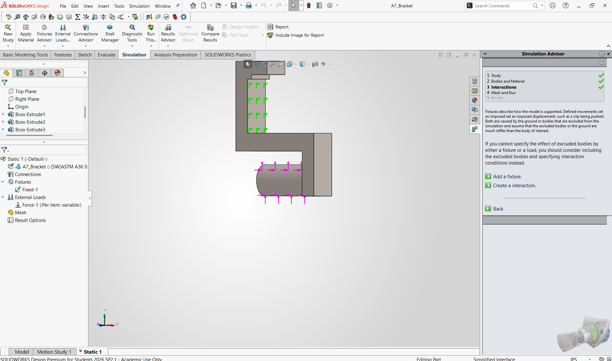
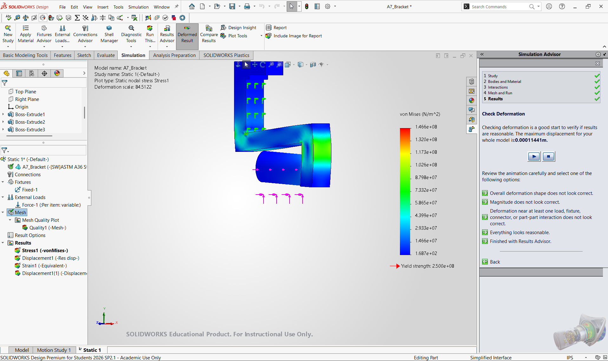
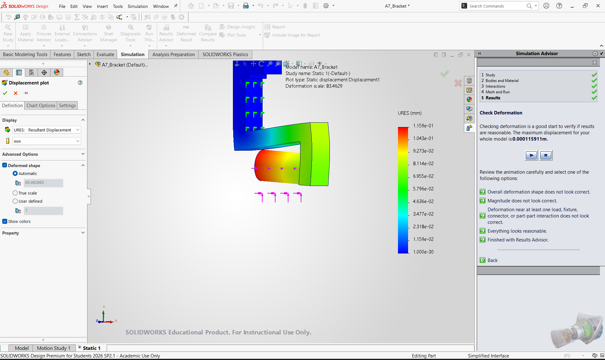

# A7 – FEA on Bracket

## Objective

Use finite element analysis (SolidWorks Simulation) to improve the A5/A6 bracket without changing the material (ASTM A36, yield 250 MPa / 36 ksi). Each design is validated with a static study (inner loop). Results must converge within 7% across mesh refinements; after three attempts the finest mesh is used. Based on the results, the geometry is changed (outer loop) for three designs.

## Design Requirements

| Requirement | Source |
|---|---|
| Material unchanged from A5/A6 (ASTM A36) | Assignment |
| Three designs, one outer-loop pass each | Assignment |
| Static study per design: constraints, loading, mesh, solve | Assignment |
| Results converge within 7%, otherwise use the finest mesh after 3 attempts | Assignment |
| CAD download link | Assignment |

## Analyze

### Material and Loading

| Setup | Value |
|---|---|
| Material | ASTM A36 steel, E = 29e6 psi, Sy = 250 MPa (36 ksi) |
| Constraint | Fixed geometry on the inner back face of the jaw (the face seated on the T-beam). Designs II and III also fix the fillet face. |
| Load | 700 lbf total on the T-beam, applied as 350 lbf on the cylinder (A5 load case), along the load path |
| Mesh | Blended curvature-based solid mesh, high quality; global sizes 0.20, 0.12 and 0.07 in per design |
| Study | Static, SolidWorks Simulation (Design Premium for Students 2026) |

### Convergence Study

Safety factor = 250 MPa / max von Mises stress. % change is relative to the previous mesh.

| Design | Mesh size | Elements | Max stress (MPa) | % change | Max disp. (mm) | % change | SF |
|---|---|---|---|---|---|---|---|
| I | 0.20 in | 4,026 | 120.0 | - | 0.1117 | - | 2.08 |
| I | 0.12 in | 18,147 | 146.6 | +22.2% | 0.1144 | +2.4% | 1.71 |
| I | 0.07 in | 76,548 | 181.2 | +23.6% | 0.1159 | +1.3% | 1.38 |
| II | 0.20 in | 3,887 | 119.3 | - | 0.1093 | - | 2.10 |
| II | 0.12 in | 17,866 | 145.8 | +22.2% | 0.1117 | +2.2% | 1.71 |
| II | 0.07 in | not recorded | 182.5 | +25.2% | 0.1128 | +1.0% | 1.37 |
| III | 0.20 in | 5,419 | 119.1 | - | 0.1074 | - | 2.10 |
| III | 0.12 in | 23,773 | 147.9 | +24.2% | 0.1096 | +2.0% | 1.69 |
| III | 0.07 in | not recorded | 185.1 | +25.2% | 0.1107 | +1.0% | 1.35 |

Displacement converges for all three designs (1.0 to 2.4% between the last two meshes, inside 7%). Maximum stress does not converge: it rises about 22 to 25% with every refinement. After three attempts, the finest mesh (0.07 in) is used, as the assignment specifies. The cause is a stress singularity at the edge of the rigidly fixed face (and, in Design I, the sharp inside corner), where theoretical stress is unbounded.

## Decide

### Outer Loop Results

| | Design I | Design II (final) | Design III |
|---|---|---|---|
| Geometry | Original A5/A6 bracket | Design I + 0.25 in fillet at the inside corner; fixture extended onto the fillet | Design II + back wall 0.375 to 0.75 in, lower arm 0.50 to 0.75 in |
| Max stress and location | 181.2 MPa (26.3 ksi), sharp inside corner, jaw back wall to lower arm | 182.5 MPa (26.5 ksi), edge where the fixed face meets the fillet | 185.1 MPa (26.8 ksi), edge where the fixed face meets the fillet |
| Max deflection and location | 0.1159 mm (0.0046 in), free end of cylinder | 0.1128 mm (0.0044 in), free end of cylinder | 0.1107 mm (0.0044 in), free end of cylinder |
| Mass | 1.03 lb (3.62 in³) | 1.03 lb (3.63 in³) | 1.38 lb (4.85 in³) |
| Safety factor | 1.38 | 1.37 | 1.35 |

### Geometry Changes and Reasoning

- **Design I to II:** Design I's hot spot was the sharp inside corner between the jaw back wall and the lower arm, so a 0.25 in fillet was added. The first run with the original fixture moved the peak to the abrupt edge of the fixed face (266 MPa, above yield), so the fixture was extended onto the fillet face. Result matched Design I at the same mass, with slightly lower deflection.
- **Design II to III:** The back wall and lower arm were thickened to 0.75 in to raise stiffness. Deflection dropped about 2% but mass rose 34%, and peak stress did not fall because the peak sits at the fixture boundary, not in the load path.
- **Final design: Design II.** Same strength as the others within the accuracy of the model, lowest mass (tied with Design I), lower deflection than Design I, and a fillet at the corner. Design III costs 34% more mass for about 2% less deflection.
- **Safety factor:** No design reaches the A5 target of 4 in this model (about 1.4 at the finest mesh). The reported stress is governed by the boundary-condition singularity and rises with refinement, so it should not be read as the true stress at that edge.

## Communicate

### Process Documentation

Constraints and loads (Design I): green symbols are the fixed jaw face, magenta arrows are the 350 lbf load on the cylinder.

Design I stress, 0.12 in mesh (max 146.6 MPa):

Design I stress, 0.07 in mesh (max 181.2 MPa, finest mesh):

Design I displacement, 0.07 in mesh (max 0.1159 mm at the free end):

Each design was saved as its own file (A7_Bracket_DesignI / II / III); Design II is the file linked below.

### Mistakes

1. The force box locked at the default value whenever a direction was chosen. Fixed by resetting the direction and re-entering 350 lbf with units set to lbf.
2. The first Design II run used the original fixture. The fillet shortened the fixed face and created an artificial stress spike (266 MPa). Fixed by adding the fillet face to the fixture.
3. Design III was assumed to help stress. Thickening made it heavier without lowering stress, which showed the peak was not in the load path.
4. Element counts for the 0.07 in meshes of Designs II and III were not recorded.

### Time Log

| Task | Time (approx.) |
|---|---|
| Study setup (material, load, fixture) | 45 min |
| Design I: three meshes and results | 40 min |
| Design II: fillet, fixture fix, three meshes | 50 min |
| Design III: geometry change, three meshes | 40 min |
| Report and portfolio | 30 min |
| **Total (start to finish)** | **about 3 h 25 min** |

### Lessons Learned

Mesh convergence must be checked for each result, not assumed. Displacement converged quickly, but stress did not, which signals a singularity in the model rather than a coarse mesh. A rigid fixture on a face edge creates its own stress concentration, so boundary conditions deserve as much thought as geometry. Making a part thicker is not an improvement if it does not move material in the load path: Design III added 34% mass for no stress benefit. Next time I would model the support more realistically (contact with the T-beam, or a fixture on a larger area with a smooth edge) so stress in the real load path can be read, and keep each design in its own saved file from the start.

## Appendix

### CAD Download

- [A7_Bracket.SLDPRT (Design II, final)](../../../cad/A7_Bracket.SLDPRT)
- [A7_Bracket_DesignI.SLDPRT (Design I, original)](../../../cad/A7_Bracket_DesignI.SLDPRT)
- [A7_Bracket_DesignII.SLDPRT (Design II)](../../../cad/A7_Bracket_DesignII.SLDPRT)
- [A7_Bracket_DesignIII.SLDPRT (Design III)](../../../cad/A7_Bracket_DesignIII.SLDPRT)
