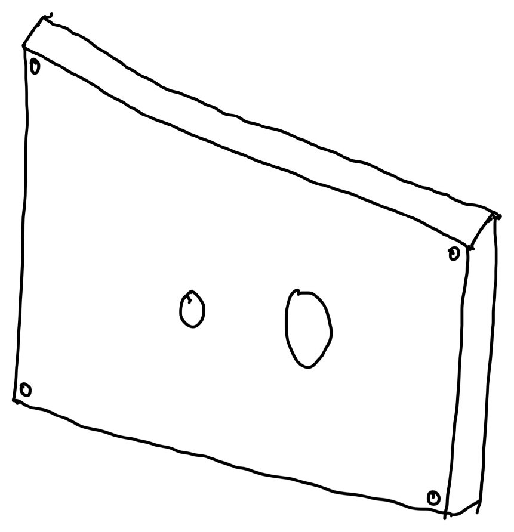
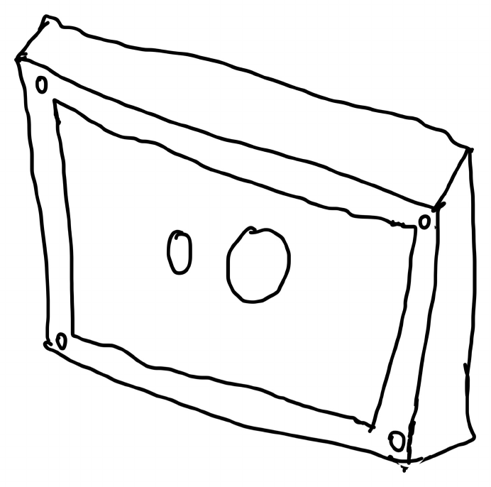
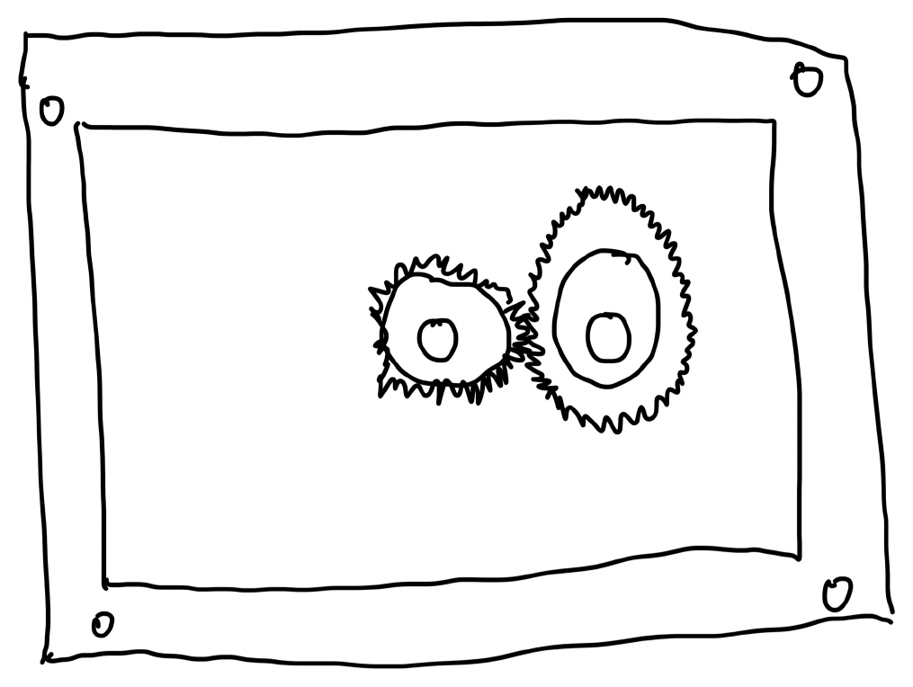
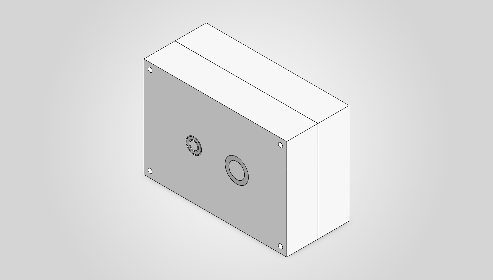
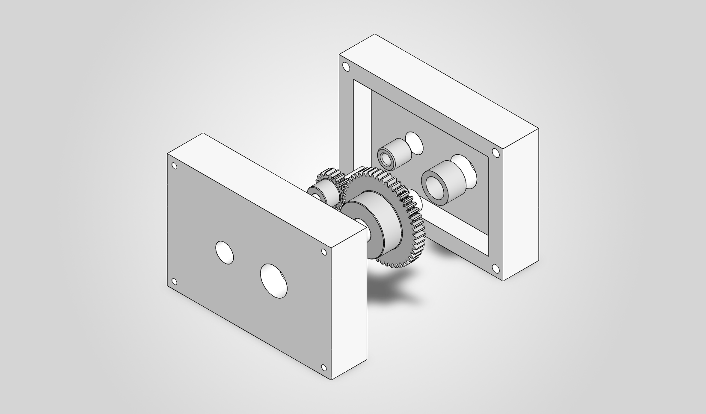
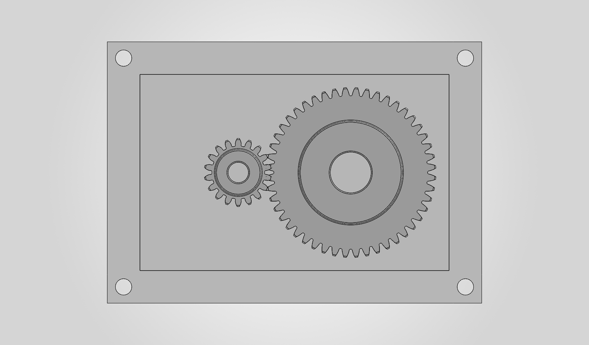
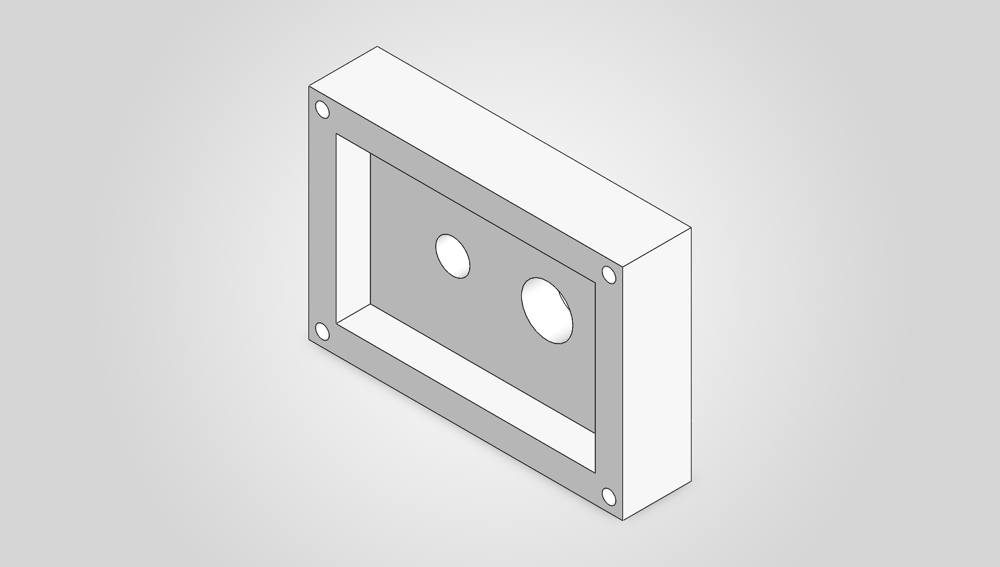
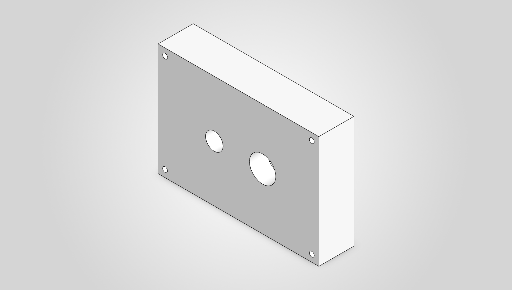

# A8: Gear Box Design

## Objective

Design a two-component gearbox that can be assembled and disassembled. A 48-tooth gear and an 18-tooth pinion (24:9 ratio) deliver 1.25 in-lbf at 1100 rpm at the output. The critical features are the two shafts (0.125 in input, 0.25 in output, 1 in long) and the journal bearings. Equations are from Machinery's Handbook (31st ed.), inch units.

## Description and Assumptions

- Ideal gear train: T_in = T_out / ratio, n_in = n_out x ratio.
- Radial gear force acts at mid-span of a 1 in simply supported shaft; the radial-force moment is neglected for primary sizing, then checked as a conservative bending case.
- Gears are press fit on the shafts; shafts run in sleeve bearings (running sliding fit); bearings are press fit in the housing; clearance between gears and housing.
- Gears: McMaster 7880K19 (18T, 48 DP, PD 0.375 in, 1/8 in bore) and 7880K24 (48T, PD 1.000 in, 1/4 in bore). Shaft: low carbon steel, Sy about 54 ksi (assumed).

## Shaft Design

n_in = 1100 x 48/18 = 2933.3 rpm; T_in = 1.25/2.667 = 0.4688 in-lbf

F_t = 2T/PD = 2(0.4688)/0.375 = 2.50 lbf; F_r = F_t tan 20 = 0.910 lbf; R = 2.660 lbf; W = R/2 = 1.330 lbf per bearing; M_max = R L/4 = 0.665 in-lbf

| Shaft | d (in) | T (in-lbf) | tau (psi) | sigma (psi) | von Mises (psi) | Safety factor |
|---|---|---|---|---|---|---|
| Input | 0.125 | 0.4688 | 1222 | 3469 | 4064 | 13.3 |
| Output | 0.250 | 1.2500 | 407 | 434 | 828 | 65.2 |

Both shafts are far below yield, so the specified diameters are sufficient.

## Journal Bearing Design

Length 0.25 in on both ends of each shaft. p = W/(K l d), V = pi d n/12 (Machinery's Handbook pp. 2408-2409, 2435-2443).

| Bearing | d (in) | n (rpm) | p (psi) | V (fpm) | PV |
|---|---|---|---|---|---|
| Input | 0.125 | 2933 | 42.6 | 96.0 | 4086 |
| Output | 0.250 | 1100 | 21.3 | 72.0 | 1532 |

Material: Handbook Table 5a (oil-impregnated copper-base) allows 500 psi at 50-100 fpm. Output bearing McMaster 6391K131 (oil-embedded 841 bronze, 1/4 in shaft, 3/8 in housing ID, 1/4 in long). Input bearing McMaster 6362K101 (Rulon LR dry-running, 1/8 in shaft, 1/4 in housing ID, 1/4 in long). Walls: 0.0625 in and 0.061 in. Fits: housing bore to bearing OD about 0.001 in interference (Handbook 0.001-0.003); running clearance on the 1/4 in shaft 0.001 in (minimum 0.0003).

## Housing Sketch

Two halves split at the shaft mid-plane; four corner screws (half A clearance holes, half B tapped); 0.25 in gear cavity per half; bearing bores through the floor.

## CAD Design / Assembly

Parametric SolidWorks parts using global variables and equations (CD = (PD_p + PD_g)/2, cavity and outer size from clearance and wall variables, bolt holes from wall size). Only the shafts and housing halves were modeled; gears and bearings are McMaster models.

## Lessons Learned

- Torsion dominates these shafts; sizing is driven by bearing length, fits and assembly rather than strength.
- Picking the real McMaster gears first fixed the pitch diameters and tooth force.
- Handbook Table 5a and the press-fit and running clearance tables make the bearing choice a pass/fail check.
- Equation-driven modeling keeps the housing consistent with the gear sizes.

## CAD Files

- [CAD folder (A8_Gearbox_CAD.zip)](https://github.com/shamardlindo1/-megr2157-portfolio/tree/main/cad)
