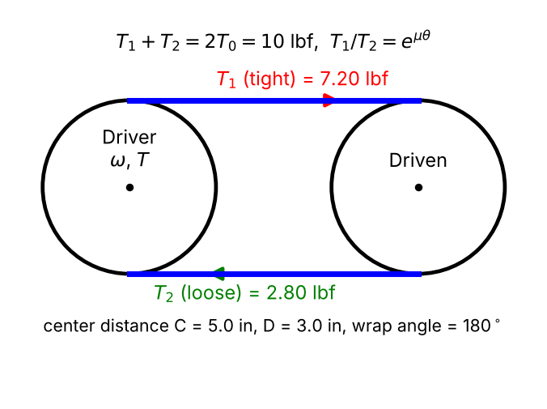
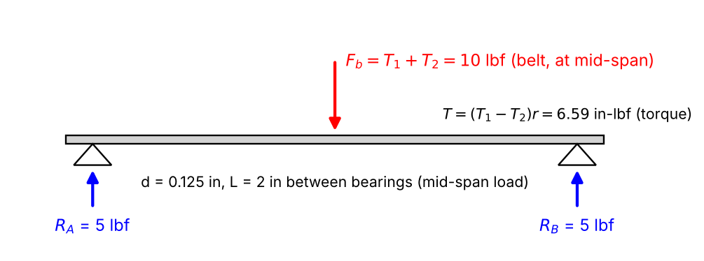
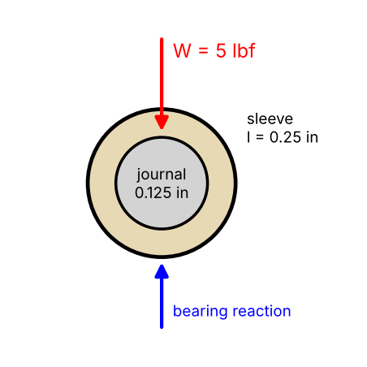
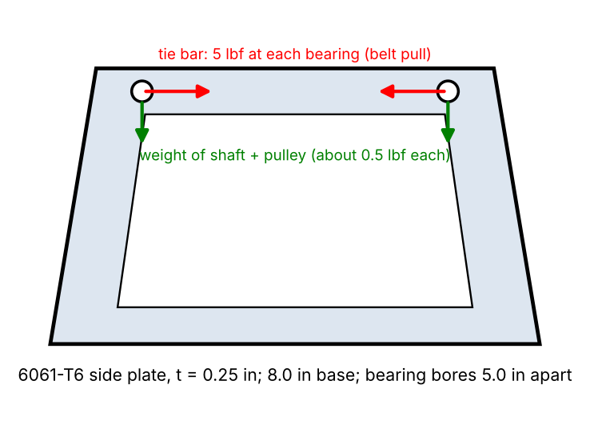
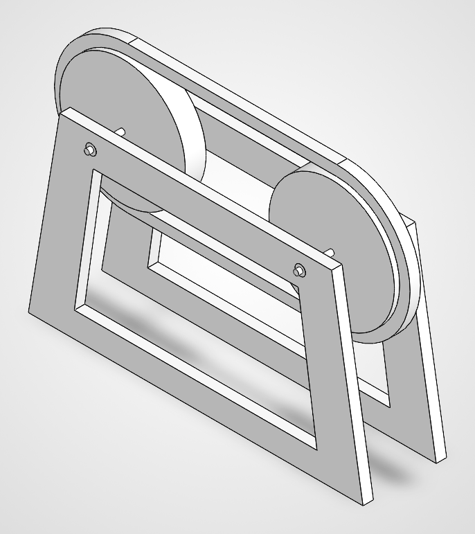
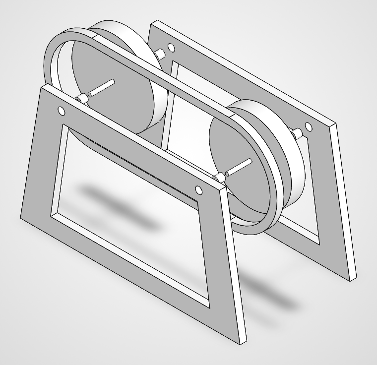
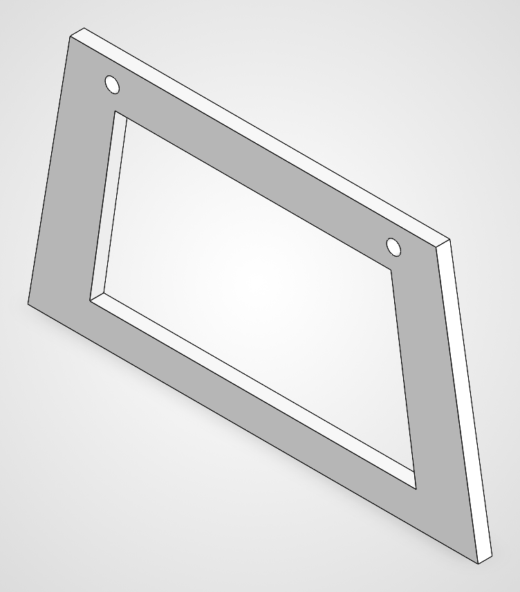

# A9: Pulley System Design

## Objective

Design a belt-and-pulley drive that transfers power between two parallel shafts. Both pulleys are 3 in in diameter, center distance 4 to 6 in, speed 1000 to 2000 rpm, static belt tension 4 to 6 lbf, minimum safety factor 3. Size a polyurethane round belt, a 1060 hardened steel shaft and a journal bearing, and design a supporting frame.

## Design Selections and Assumptions

| Quantity | Value | Basis |
|---|---|---|
| Pulley diameter D | 3.0 in (both) | Given |
| Center distance C | 5.0 in | Selected |
| Speed n | 1500 rpm | Selected |
| Static tension T0 | 5 lbf | Selected |
| Friction coefficient mu | 0.3 | Assumed (polyurethane on aluminum) |
| Belt yield strength | 471 psi (3.25 MPa) | Given |
| Safety factor | 3 | Given |
| Shaft material | 1060 hardened steel, Sy = 100 ksi | Handbook range 100 to 180 ksi, lowest used |
| Pulley / frame material | 6061-T6 aluminum, Sy = 40 ksi | Selected |

- Static tension is the average of the two sides: T0 = (T1 + T2)/2.
- No slip: T1/T2 = e^(mu theta), theta = pi for equal pulleys.
- Belt weight and centrifugal tension are neglected (belt speed is 98 ft/min).

## Belt Selection

**Knowns:** D = 3 in, C = 5 in, T0 = 5 lbf, mu = 0.3, theta = pi, Sy = 471 psi, SF = 3. **Unknowns:** T1, T2, area A, belt diameter d, outer circumference.

Symbolic: T1 + T2 = 2 T0; T1/T2 = exp(mu theta); A = T1 SF / Sy; d = sqrt(4A/pi); L = 2C + pi D.

Numerical: exp(0.3 pi) = 2.566; T2 = 2.804 lbf; T1 = 7.196 lbf; sigma_allow = 471/3 = 157 psi; A = 0.0458 in^2; d_min = 0.242 in; L = 19.42 in (installed).

**Selected belt:** McMaster-Carr 3044K606, 1/4 in diameter polyurethane round belt. Actual area 0.0491 in^2, tight-side stress 147 psi, safety factor 3.21. Unstretched outer circumference about 19 1/2 in (static strain 4.3%).

## Shaft Diameter Design

**Knowns:** T1 = 7.20 lbf, T2 = 2.80 lbf, r = 1.5 in, 1060 hardened steel Sy = 100 ksi, SF = 3. **Unknowns:** torque T, allowable shear stress, minimum diameter.

Symbolic: T = (T1 - T2) r; tau = 16 T / (pi d^3); tau_allow = 0.577 Sy / SF; d_min = (16 T / (pi tau_allow))^(1/3).

Numerical: T = 6.588 in-lbf; tau_allow = 19,233 psi; d_min = 0.1204 in. **Selected shaft diameter 0.125 in**, tau = 17,179 psi, safety factor 3.36.

## Journal Bearing Design

**Knowns:** d = 0.125 in, n = 1500 rpm, belt load 10 lbf shared by two bearings, length l = 0.25 in (assumed). **Unknowns:** load W, pressure p, velocity V, PV, material.

Model: W = (T1 + T2)/2; p = W/(l d); V = pi d n / 12; PV = p V.

Numerical: W = 5.0 lbf; p = 160 psi; V = 49.1 ft/min; PV = 7,854 psi-ft/min.

| Material (Handbook Table 4, p. 2440) | Max P (psi) | Max V (fpm) | PV limit | Acceptable? |
|---|---|---|---|---|
| Porous bronze | 4500 | 1500 | 50,000 | Yes (PV margin 6.4x) |
| Graphite (dry) | 600 | 2500 | 15,000 | Yes (margin 1.9x) |
| Acetal / Nylon | 1000 | 1000 | 3000 | No |
| Reinforced Teflon | 2500 | 1000 | 10,000 to 15,000 | Marginal |

**Selected material: porous (oil-impregnated) bronze.** Largest PV margin, self-lubricating, standard sintered sleeve bearing.

## Frame Design

**Knowns:** bearing reaction 5 lbf per bearing toward the other shaft, weight about 0.5 lbf per shaft and pulley, C = 5.0 in, 6061-T6 (Sy = 40 ksi, E = 10 Msi), plate t = 0.25 in.

Two identical A-frame side plates (8.0 in base, 6.5 in top, 4.5 in tall, t = 0.25 in) carry the shafts. The top tie bar on the line of centers carries the belt pull in simple tension.

- Tie bar (0.75 x 0.25 in): stress = 5/0.1875 = 26.7 psi, SF about 1500.
- Bearing bore: 80 psi, SF about 500.
- Leg buckling: Pcr about 4,555 lbf vs about 0.4 lbf weight per leg.
- Torque reaction 6.59 in-lbf over the 8 in base: stable.

All safety factors are far above 3, so geometry and stiffness set the frame design, not strength.

## CAD Design / Assembly

## Time

The assignment took me a total of 6 hrs to complete.

## Lessons Learned

- Static tension is the mean of the tight and loose tensions, and the capstan relation T1/T2 = e^(mu theta) fixes both once the friction coefficient and wrap angle are known; the tight side (7.20 lbf, 44% above the static value) governs belt stress.
- Belt safety factor depends on the loaded cross-section: the minimum diameter (0.242 in) is only 3% under the 1/4 in stock size, so the standard size sets the real safety factor (3.21).
- The shaft is governed by torque, T = (T1 - T2) r = 6.59 in-lbf; the minimum diameter 0.120 in rounds up to 0.125 in with a safety factor of 3.36.
- Bearing selection is a three-limit check (p, V and PV); the PV product (7,854) separates acceptable materials (porous bronze, 50,000) from unacceptable ones (acetal, 3000).
- In the frame, the belt pull is an internal force pair along the line of centers, so a tie bar in tension carries it; strength is not limiting, so geometry and stiffness decide the design.

## CAD Files

- [CAD folder (A9_Pulley_CAD.zip)](https://github.com/shamardlindo1/-megr2157-portfolio/tree/main/cad)
