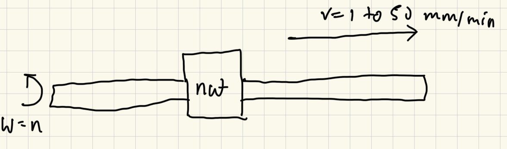
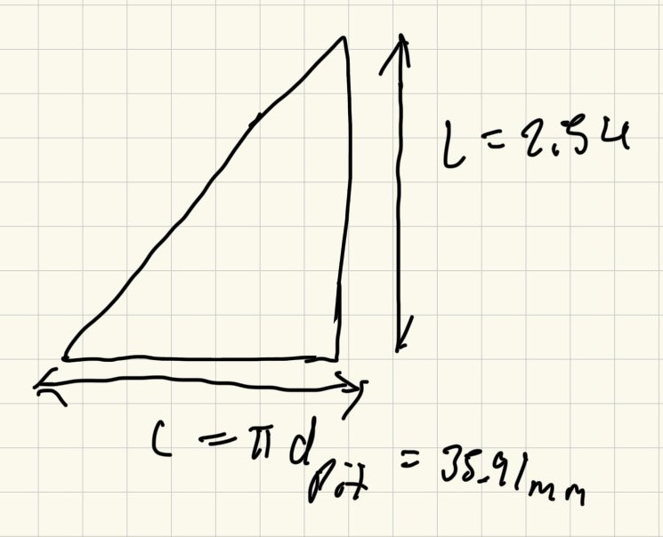
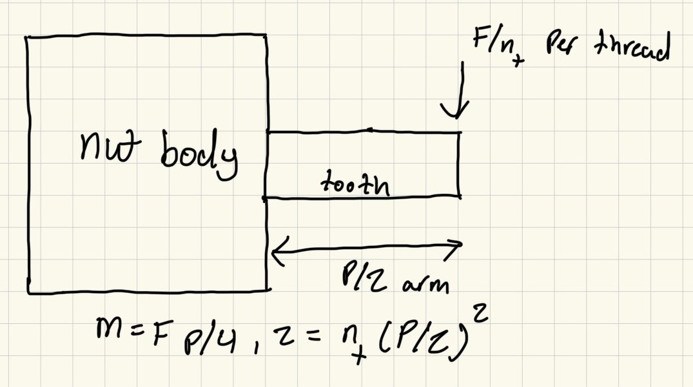
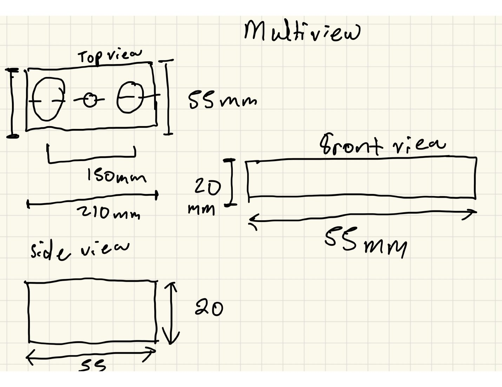

# A10 – Lead Screw Translating System

## Group Portfolio: Lead Screw Design

Tensile tester drive: two identical lead screws share a 2 kN test load (1000 N each), speed range 1 to 50 mm/min, minimum screw length 18 in, safety factor 4. The screws are spaced 150 mm center to center.

## Leadscrew Diameter, Speed, Torque & Flange Nut Selection (Shamar Lindo)

For my part of the project, I sized the lead screw drivetrain for our 2 kN tensile tester. I worked through the minimum screw diameter from axial stress, found the rotational speed range needed for the 1 to 50 mm/min crosshead speeds, calculated the maximum input torque per screw, and verified the thread strength of a rated bronze flange nut (97790A110) from McMaster-Carr so the team has the exact mounting dimensions for the crosshead and CAD assembly.

<iframe src="A10_Shamar_Leadscrew_Handwritten.pdf" width="100%" height="620px" style="border:1px solid #ccc;"></iframe>

### Free Body Diagrams

**Speed (nut advancing on the rotating screw)**

**Torque (unwrapped thread helix)**

{ width="60%" }

**Nut thread tooth (bending)**

### Component Selection & Design Notes

- **Dual-screw load split:** I placed two identical screws 150 mm center to center so they split the 2000 N test load evenly, which gives F = 1000 N (224.8 lbf) per screw and keeps the crosshead balanced.
- **Leadscrew size:** Axial stress with a safety factor of 4 only requires a 2.72 mm root diameter (4140 steel, Sy ≈ 689 MPa), so I went with the standard McMaster [98940A305](https://www.mcmaster.com/98940A305/) 1/2"-10 Acme screw (root diameter 10.16 mm, 18 in long). It gives a safety factor of 56 and plenty of stiffness over the 18 in minimum length.
- **Why part 97790A110:** I chose the [97790A110](https://www.mcmaster.com/97790A110/) 932 bearing bronze Acme nut because it is explicitly rated for 1,200 lb of dynamic thrust. Against our 224.8 lbf per screw that gives a real safety factor of 5.34, and McMaster offers SolidWorks CAD so the team can drop it straight into the assembly.
- **Self-locking lead:** The single-start 0.1 in lead (L < μC) means the system will not back-drive when the motor stops, and it only needs 1.28 N·m of input torque per screw at peak load.

### Analytical Calculations

**Baseline inputs:** F = 1000 N per screw, SF = 4, μ = 0.15, lead L = pitch p = 2.54 mm, dpit = 11.43 mm, dmin = 10.16 mm.

**1. Minimum diameter (axial stress):** dmin = √(4 F SF / (π Sy)) = √(4·1000·4 / (π·689)) = **2.72 mm** → screw root 10.16 mm, σ = 12.3 MPa, SF = 56.

**2. Rotational speed range:** n = v / L → nmin = 1/2.54 = **0.39 rpm**, nmax = 50/2.54 = **19.69 rpm**.

**3. Maximum torque per screw:** Fh = P (μC + L)/(C − μL) = 223.1 N (C = π dpit = 35.91 mm), T = Fh dpit/2 = **1.28 N·m** per screw (2.55 N·m total). Efficiency 32%, self-locking.

**4. Flange nut thread check:** nt = 44.45/2.54 = 17.5 threads, σbend = 6F/(nt π dmin p) = 4.2 MPa (SF = 29), τt = 1.9 MPa (SF = 37), manufacturer rating SF = 1200/224.8 = **5.34 ≥ 4**.

### Handoff Specs for Crosshead & CAD

| Component | Part & Material | Key Dimensions | Rating | Notes for Crosshead / Assembly |
|---|---|---|---|---|
| Leadscrews (x2) | McMaster [98940A305](https://www.mcmaster.com/98940A305/), 1/2"-10 Acme, black-oxide 4140 steel | Ø0.500 in nominal, 18.0 in long, lead 0.100 in (2.54 mm), right hand, single start, Class 2C | 125 ksi tensile | Spaced 150 mm center to center |
| Flange Nuts (x2) | McMaster [97790A110](https://www.mcmaster.com/97790A110/), 932 bearing bronze | Barrel Ø1.000 in, length 1.750 in, flange Ø2.000 in x 0.375 in | 1,200 lb thrust | Ø26 mm clearance hole in crosshead, drill 4x Ø0.201 in (#10) on a 1.5 in bolt circle in the plain flange |

## Crosshead Design (Shamar Lindo)

<iframe src="A10_Shamar_Crosshead_Handwritten.pdf" width="100%" height="620px" style="border:1px solid #ccc;"></iframe>

### Notes on Work

I treated the crosshead as a simply supported beam on the two nuts (L = 150 mm) with the full 2 kN at midspan from the specimen grips. I chose 6061-T6 aluminum (Sy = 276 MPa, E = 68.9 GPa), and I set the base width from the 50.8 mm nut flange, which gave b = 55 mm.

The stress analysis (Mmax = PL/4 = 75,000 N·mm, SF = 4) only required a bar height of 10.9 mm. However, the 0.1 mm deflection limit needs I ≥ 20,410 mm⁴, a height of at least 16.5 mm, so **stiffness governs** the design. I rounded up to a **55 x 20 mm bar**: σ = 20.5 MPa (SF 13.5) and δmax = 0.056 mm (0.066 mm with the Ø8.5 mm grip hole).

### Multiview Sketch

Final crosshead: **6061-T6 aluminum bar 55 x 20 x 210 mm**, two Ø26 mm nut-barrel holes 150 mm apart, four #10 clearance holes per flange on a 38.1 mm bolt circle, and a Ø8.5 mm center hole for the grip adapter.

## Bill of Materials & Cost Analysis (Shamar Lindo)

| Item # | Qty | Name | Cost / Item | Total Cost | Purchase Link |
|:---:|:---:|---|:---:|:---:|---|
| 1 | 2 | Precision Acme Lead Screw, 4140 Alloy Steel, 1/2"-10 Thread, 18 in. Long | $28.64 | $57.28 | [Link](https://www.mcmaster.com/98940A305/) |
| 2 | 2 | Precision Acme Flange Nut, 932 Bearing Bronze, 1/2"-10 Thread | $178.60 | $357.20 | [Link](https://www.mcmaster.com/97790A110/) |
| 3 | 4 | T-Slotted Framing Single Rail, 40 mm x 40 mm, 2 ft. Long | $21.15 | $84.60 | [Link](https://www.mcmaster.com/6575N25-6575N183/) |
| 4 | 8 | T-Slotted Framing Bracket | $7.06 | $56.48 | [Link](https://www.mcmaster.com/5537T937/) |
| **Total** |  |  |  | **$555.56** |  |
