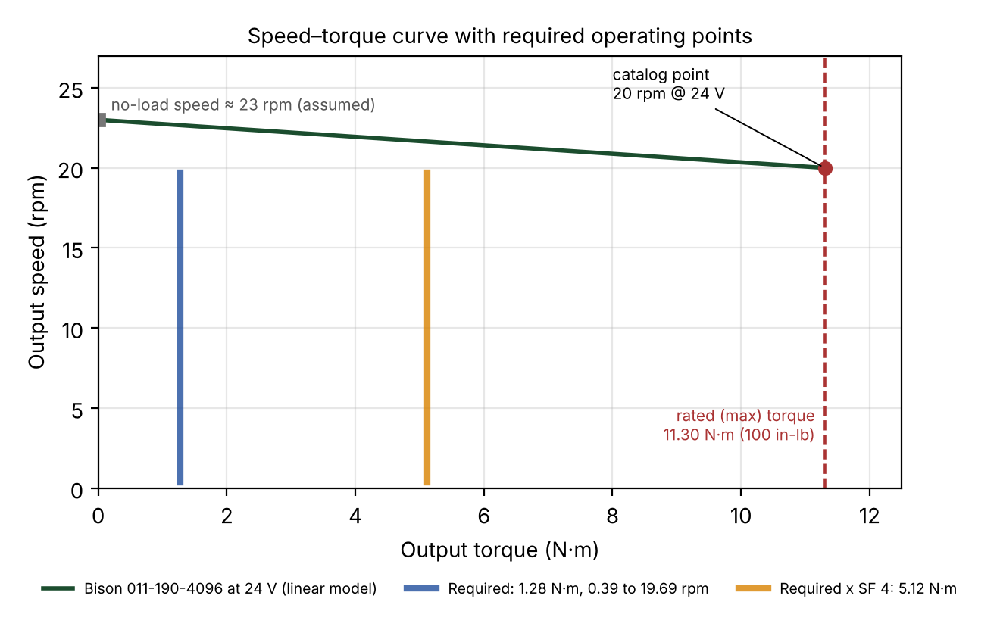
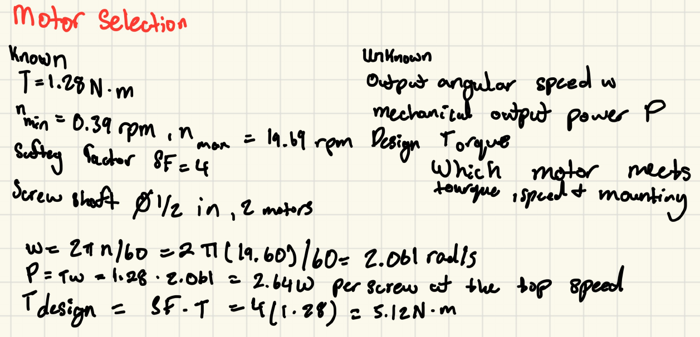
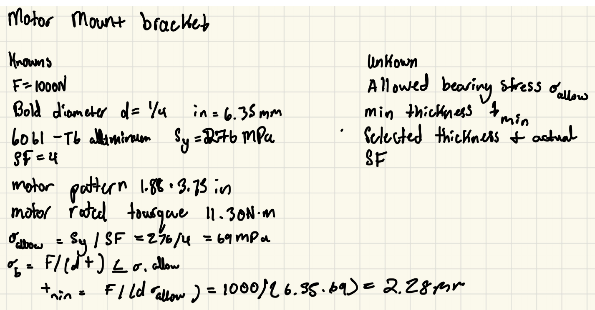
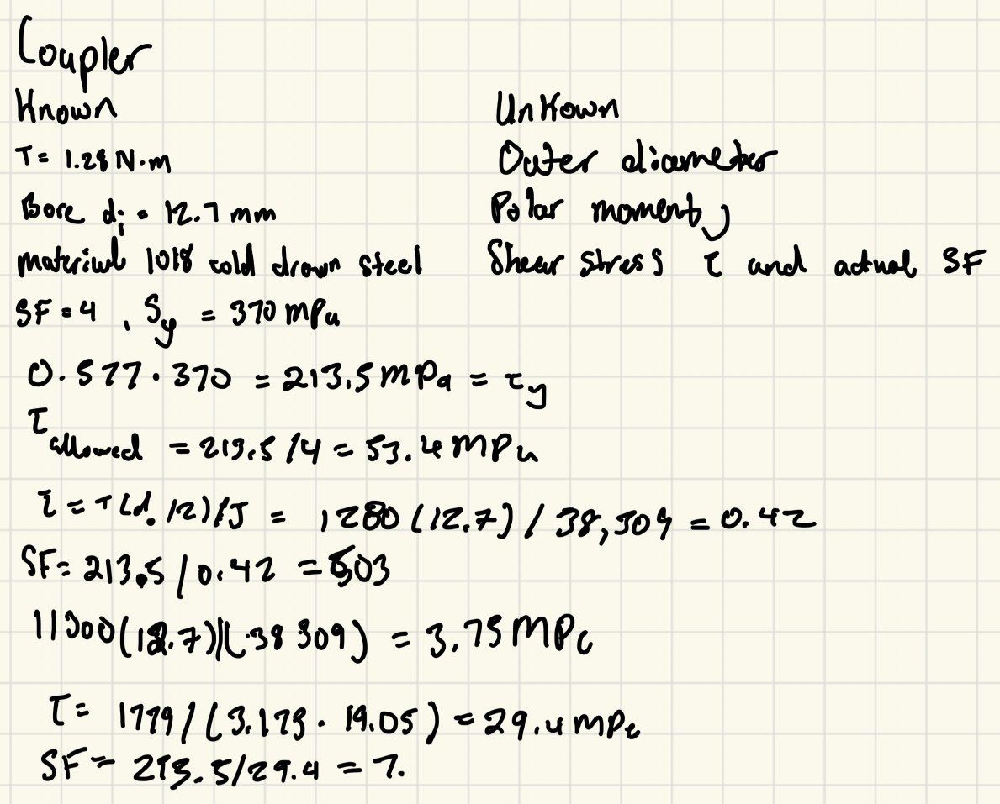
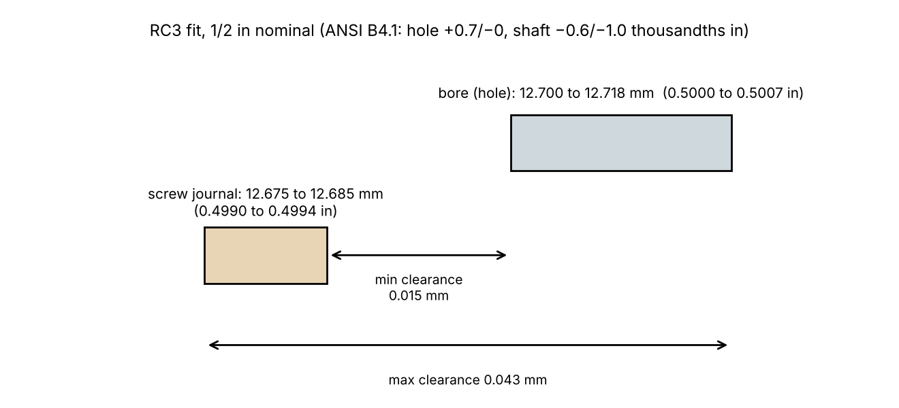

# A11 – Motor Selection Design

## Group Portfolio: Motor Selection Design

Tensile tester drive: two identical lead screws share a 2 kN test load (1000 N each), speed range 1 to 50 mm/min, 18 in minimum screw length, safety factor 4. Each screw needs 1.28 N·m of input torque at a top speed of 19.69 rpm.

## Motor Selection & Shaft Coupler (Shamar Lindo)

For my part of the project, I selected the motor for each lead screw, sized the motor mount bracket for bearing stress, and sized the coupler that joins the motor shaft to the screw. I took the 1.28 N·m peak torque and the 0.39 to 19.69 rpm speed range from my A10 lead screw design, applied the safety factor of 4, and picked a 24 V DC gearmotor with a Ø1/2 in shaft to match the screw. Then I found the minimum bracket thickness and sized the coupler for torsional shear so the team has the exact shaft, bore and mounting dimensions for the mount, frame and CAD assembly. I also did the frame, bearing mount and cost calculations, and left the CAD modeling to the teammates.

### Speed–Torque Curve

**Selected motor: Bison Gear & Engineering permanent-magnet DC gearmotor, Mfr # 011-190-4096** ([Zoro # G9650947](https://www.zoro.com/bison-gear-engineering-dc-gearmotor-20rpm-24v-011-190-4096/i/G9650947))

| Parameter | Value |
|---|---|
| Type / duty | Permanent magnet DC gearmotor, continuous duty, IP43 |
| Supply voltage | 24 V DC |
| Output speed | 20 rpm at 24 V (gear ratio 95.5:1) |
| Rated (maximum) torque | 100 in-lb = 11.30 N·m |
| Full load current | 2.4 A (57.6 W input) |
| Efficiency at rated load | 23.7 W output / 57.6 W input = 41% |
| Output shaft | Ø1/2 in, keyed, 1/8 in square key, keyway 3/4 in long |
| Mounting interface | 4 holes Ø0.28 in on a 1.88 in x 3.75 in pattern (47.8 x 95.3 mm) |
| Cost | $657.99 each, 2 required = $1,315.98 |

**Verification:** The motor's 11.30 N·m rating is 8.83 times the 1.28 N·m working torque and above the 5.12 N·m design torque, so it passes with the safety factor of 4 applied. The catalog gives 20 rpm at 24 V at the rated torque, and a DC motor runs faster at lighter loads, so at 1.28 N·m it is above the 19.69 rpm needed. Speed is lowered by reducing the supply voltage. The working-load current is about 2.4 A × (1.28 / 11.30) = 0.27 A, and the Ø1/2 in shaft matches the Ø1/2 in lead screw.

### Motor Mount Bracket

### Shaft Coupler

### Component Selection & Design Notes

- **Motor selection (Bison 011-190-4096):** The screw needs 2.64 W at top speed (P = Tω = 1.28 × 2.061 rad/s), and 5.12 N·m once the safety factor of 4 is applied to the torque. This permanent-magnet DC gearmotor is rated for 100 in-lb (11.30 N·m) at 20 rpm on 24 V, which gives a torque margin of 8.8 on the working load and covers the 19.69 rpm top speed. It draws 2.4 A at full load, has a Ø1/2 in keyed output shaft, and costs $657.99 each (two needed).
- **Why this motor:** Its Ø1/2 in shaft matches the Ø1/2 in lead screw, so the coupler has the same bore on both ends. Speed is set by lowering the supply voltage, and at the 1.28 N·m working load the motor runs faster than its 20 rpm rating, so the top speed is covered.
- **Motor mount bracket thickness:** Using a 6061-T6 aluminum plate (Sy = 276 MPa, SF 4, so 69 MPa allowable) with a 1/4 in (6.35 mm) bolt under a 1000 N reference load, the minimum bearing thickness is 2.28 mm. I selected a 6.35 mm (1/4 in) plate for stiffness against the motor's reaction torque and to keep the motor square to the screw, which gives a bearing safety factor of 11.1. The motor's rated torque only puts 53 N on each of its four bolts.
- **Coupler sizing:** With a 1018 steel coupler (Sy = 370 MPa, τallow = 53.4 MPa at SF 4) and a 12.7 mm bore, torsional shear needs only a 12.9 mm outer diameter at 1.28 N·m (14.3 mm at the motor's full rated torque). I selected a 25.4 mm OD so there is a 6.35 mm wall for the keyway and set screws, which gives a shear safety factor of 57 at the motor's rated torque.
- **Key check:** The 1/8 in square key (19.05 mm long) sees 29.4 MPa at the motor's rated torque, a safety factor of 7.3.
- **Assumption:** The catalog does not list the motor's no-load speed, so the curve uses 23 rpm as an assumed value. The result does not depend on it, because every point at less than rated torque runs faster than the catalog's 20 rpm.

### Analytical Calculations

**Baseline inputs:** T = 1.28 N·m per screw, n = 0.39 to 19.69 rpm, SF = 4, motor shaft Ø1/2 in, coupler bore di = 12.7 mm.

**1. Speed and power:** ω = 2π(19.69)/60 = **2.061 rad/s**, P = Tω = 1.28 × 2.061 = **2.64 W** per screw.

**2. Design torque:** Tdesign = SF · T = 4 × 1.28 = **5.12 N·m** ≤ 11.30 N·m rated, so the motor passes (margin 8.83 on the working torque).

**3. Motor current at working load:** I ≈ 2.4 A × (1.28 / 11.30) = **0.27 A**.

**4. Motor mount bracket thickness:** σallow = 276/4 = **69 MPa**, tmin = F/(d σallow) = 1000/(6.35 × 69) = **2.28 mm** → **6.35 mm** selected. Actual σb = 1000/(6.35 × 6.35) = 24.8 MPa (SF 11.1). Torque reaction: r = 53.3 mm, F = 11,300/(4 × 53.3) = 53 N per bolt.

**5. Coupler shear stress:** τy = 0.577 Sy = 213.5 MPa, τallow = 213.5/4 = **53.4 MPa**. τ = T(do/2)/J with J = π(do4 − di4)/32 gives do,min = **12.89 mm** at 1.28 N·m and **14.26 mm** at 11.30 N·m.

**6. Selected coupler:** do = 25.4 mm, J = 38,309 mm⁴, τ = **0.42 MPa** at 1.28 N·m (SF 503) and **3.75 MPa** at 11.30 N·m (SF 57).

### Handoff Specs for Mount, Frame & CAD

| Component | Part & Material | Key Dimensions | Rating | Notes for Mount / Assembly |
|---|---|---|---|---|
| Motors (x2) | Bison 011-190-4096, 24 V DC permanent-magnet gearmotor | Ø1/2 in keyed shaft (1/8 in key), 4 mounting holes Ø0.28 in on a 1.88 in x 3.75 in pattern, 8.41 in long, 3.75 in wide | 100 in-lb (11.30 N·m), 20 rpm, 2.4 A | Use the 1.88 x 3.75 in hole pattern for the bracket; one motor per screw |
| Motor Mount Bracket (x2) | 6061-T6 aluminum plate | 6.35 mm (1/4 in) thick (exceeds the 2.28 mm bearing minimum), four Ø0.28 in holes on the motor's 1.88 in x 3.75 in pattern, clear center hole for the shaft | σallow = 69 MPa (SF 4) | Four-hole pattern to the frame and CAD model still to be added by the teammate doing the frame |
| Couplers (x2) | 1018 steel, hollow shaft | Ø25.4 mm OD, Ø12.7 mm bore both ends, 63.5 mm long | Shear SF 57 at 11.30 N·m | Keyed to the motor shaft, set screws on the screw end |

## Frame Connectors, Top-of-Frame & Vertical Frame Analysis (Shamar Lindo)

I checked the frame with hand calculations and a beam-element FEA. The frame is four 2 ft McMaster 6575N25 40 mm rails (two columns, a top rail and a bottom rail) joined at the four corners with eight McMaster 5537T937 corner brackets (6063-T5 aluminum, two M8 screws each). McMaster does not publish section properties for the rail, so I used the published values for the equivalent 40 mm 40 Series profile (I = 137,870 mm⁴, A = 874.2 mm², Sy = 172.4 MPa, E = 68.9 GPa). They should be replaced with the mass-properties values from the CAD model.

### Frame Analysis Notes

- **Connectors:** Each corner carries a 1000 N reaction on four M8 screws (two brackets), so each screw sees 250 N and 6.8 MPa of shear. Assuming a low-grade screw (Sy = 240 MPa) the safety factor is 20. The motors' reaction torques only add 4.5 N at the rail ends, so twist is negligible. McMaster does not publish a pullout rating for the drop-in nuts, so the screw shear check is the limit I could verify.
- **Top rail:** Simply supported over 569.6 mm with two 1000 N loads 150 mm apart, Mmax = 209,800 N·mm, σ = 30.4 MPa (SF 5.7) and a midspan deflection of 0.733 mm (L/777). The beam-element model gives the same values at 8, 16, 32 and 64 elements.
- **Vertical columns:** Each column carries 1000 N axial plus an assumed 50 N side load (5% of the axial load) at the top, fixed at the base. The combined stress is 5.56 MPa (SF 31), the top deflection is 0.397 mm and Euler buckling gives a safety factor of 63.
- **Load path and optimization:** The 1000 N screw loads go through the motor plate into the top rail, then through the corner brackets into the columns and down to the base. Both members have a large margin, so strength does not need stiffening. A second top rail would halve the rail deflection if that is wanted.
- **Left for the CAD teammates:** the 3D model of the frame, and the solid-mesh FEA run with local refinement at the bracket holes.

## Floating Bearing Mount (Shamar Lindo)

The floating bearing at the bottom of each screw is a 90 x 40 x 20 mm 6061-T6 block with an oil-impregnated bronze sleeve, bolted to the bottom rail with two M8 bolts through Ø9.0 mm holes 60 mm apart.

- **RC3 fit:** The bore is Ø12.700 mm (0.5000 in) with +0.018 / −0 mm. The screw end is turned to a journal of Ø12.675 to 12.685 mm (0.4990 to 0.4994 in), which gives 0.015 to 0.043 mm of clearance.
- **Bore length:** 20 mm (L/d = 1.6). Radial bearing pressure from a 50 N side load is only 0.20 MPa.
- **Axial float:** At least 2 mm of gap at the screw tip, since the screw grows 0.107 mm for a 20 K rise.
- **Bolt holes:** Ø9.0 mm is the normal clearance for M8 (ISO 273: 8.4 close, 9.0 normal, 10.0 loose). The 15 mm edge distance is 1.7 hole diameters, and each bolt sees only about 25 N.

## Bill of Materials & Design Cost (Shamar Lindo)

| Item # | Qty | Name | Cost / Item | Total Cost | Purchase Link |
|:---:|:---:|---|:---:|:---:|---|
| 1 | 2 | Precision Acme Lead Screw, 4140 Alloy Steel, 1/2"-10 Thread, 18 in. Long | $28.64 | $57.28 | [Link](https://www.mcmaster.com/98940A305/) |
| 2 | 2 | Precision Acme Flange Nut, 932 Bearing Bronze, 1/2"-10 Thread | $178.60 | $357.20 | [Link](https://www.mcmaster.com/97790A110/) |
| 3 | 4 | T-Slotted Framing Single Rail, 40 mm x 40 mm, 2 ft. Long | $21.15 | $84.60 | [Link](https://www.mcmaster.com/6575N25-6575N183/) |
| 4 | 8 | T-Slotted Framing Corner Bracket, 40 mm | $7.06 | $56.48 | [Link](https://www.mcmaster.com/5537T937/) |
| 5 | 2 | Bison DC Gearmotor, 24 V, 20 rpm, 100 in-lb (011-190-4096) | $657.99 | $1,315.98 | [Link](https://www.zoro.com/bison-gear-engineering-dc-gearmotor-20rpm-24v-011-190-4096/i/G9650947) |
| 6 | 2 | Shaft coupler, 1018 steel, Ø25.4 x 63.5 mm (machined) | stock price to confirm | to confirm | |
| 7 | 2 | Motor mount plate, 6061-T6, 6.35 mm (machined) | stock price to confirm | to confirm | |
| 8 | 2 | Floating bearing block, 6061-T6 with bronze sleeve (machined) | stock price to confirm | to confirm | |
| 9 | 1 | Crosshead, 6061-T6 bar 55 x 20 x 210 mm (machined) | stock price to confirm | to confirm | |
| **Total of priced parts** | | | | **$1,871.54** | |

| Person | A10 Hours | A11 Hours | Total Hours | Cost @ $35/hr |
|---|:---:|:---:|:---:|:---:|
| Shamar Lindo | 5 | to fill in | | to fill in |
| Addison Fagan | 4 | to fill in | | to fill in |
| Matthew Cowan | 4 | to fill in | | to fill in |

## CAD Assembly & Component Notes (Shamar Lindo)

These are the dimensions I handed off so the motor and coupler can be modeled and mated in the assembly.

- **Motor:** The Bison 011-190-4096 body is 8.41 in long and 3.75 in wide with four Ø0.28 in mounting holes on a 1.88 in x 3.75 in pattern. The output shaft is Ø1/2 in with a 1/8 in square key and a 1 7/16 in output connection depth. If the manufacturer's CAD file is not available, the motor can be modeled as a block envelope with these catalog dimensions.
- **Coupler:** I did not download this part. It is modeled from my dimensions as a Ø25.4 mm x 63.5 mm cylinder with a Ø12.7 mm bore on each end, a 1/8 in keyway on the motor end, and a set screw on the lead screw end.
- **Lead screw interface:** The coupler's screw end bore is the same Ø1/2 in as the McMaster 98940A305 Acme screw from A10, so the screw end slides straight into the coupler.
- **Axial clearance verification:** The assembly layout must leave room between the motor face and the screw end for the 1 7/16 in (36.5 mm) of motor shaft and the 63.5 mm coupler length without the shaft and screw touching, with at least 19 mm of screw engaged in the coupler.

## Lessons Learned & Project Takeaways (Shamar Lindo)

I learned how to turn a lead screw torque and speed requirement into motor requirements: converting rpm to rad/s, finding mechanical power with P = Tω, and applying the safety factor of 4 to the torque. I learned that a gearmotor catalog speed is listed at the rated torque, not at no load. I first read the 20 rpm as a no-load speed, which made the motor look like it would only reach 17.7 rpm under load. Checking the output power (11.30 N·m at 20 rpm is 23.7 W, about 1/20 hp, which matches the motor's rating) showed the 20 rpm is the loaded speed, so the motor runs faster at the lighter 1.28 N·m load. I also learned to apply the hollow-shaft torsion equation with the 0.577 Sy shear yield limit and solve for the outer diameter at a fixed bore. Strength only needed a 14.3 mm outer diameter, so the standard 25.4 mm size is controlled by the keyway, set screws and bore fit rather than by stress.
