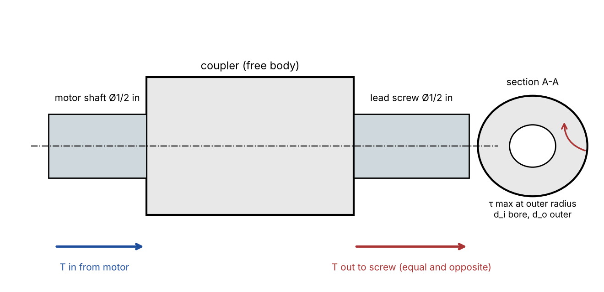

# A11 – Motor Selection Design

## Group Portfolio: Motor Selection Design

Tensile tester drive: two identical lead screws share a 2 kN test load (1000 N each), speed range 1 to 50 mm/min, 18 in minimum screw length, safety factor 4. Each screw needs 1.28 N·m of input torque at a top speed of 19.69 rpm.

## Motor Selection & Shaft Coupler (Shamar Lindo)

For my part of the project, I selected the motor for each lead screw and sized the coupler that joins the motor shaft to the screw. I took the 1.28 N·m peak torque and the 0.39 to 19.69 rpm speed range from my A10 lead screw design, applied the safety factor of 4, and picked a 24 V DC gearmotor with a Ø1/2 in shaft to match the screw. Then I sized the coupler for torsional shear so the team has the exact shaft, bore and mounting dimensions for the mount, frame and CAD assembly.

<iframe src="A11_Shamar_Lindo_Motor_Coupler.pdf" width="100%" height="620px" style="border:1px solid #ccc;"></iframe>

### Speed–Torque Curve

### Coupler Free Body Diagram

### Component Selection & Design Notes

- **Motor selection (Bison 011-190-4096):** The screw needs 2.64 W at top speed (P = Tω = 1.28 × 2.061 rad/s), and 5.12 N·m once the safety factor of 4 is applied to the torque. This permanent-magnet DC gearmotor is rated for 100 in-lb (11.30 N·m) at 20 rpm on 24 V, which gives a torque margin of 8.8 on the working load and covers the 19.69 rpm top speed. It draws 2.4 A at full load, has a Ø1/2 in keyed output shaft, and costs $657.99 each (two needed).
- **Why this motor:** Its Ø1/2 in shaft matches the Ø1/2 in lead screw, so the coupler has the same bore on both ends. Speed is set by lowering the supply voltage, and at the 1.28 N·m working load the motor runs faster than its 20 rpm rating, so the top speed is covered.
- **Coupler sizing:** With a 1018 steel coupler (Sy = 370 MPa, τallow = 53.4 MPa at SF 4) and a 12.7 mm bore, torsional shear needs only a 12.9 mm outer diameter at 1.28 N·m (14.3 mm at the motor's full rated torque). I selected a 25.4 mm OD so there is a 6.35 mm wall for the keyway and set screws, which gives a shear safety factor of 57 at the motor's rated torque.
- **Key check:** The 1/8 in square key (19.05 mm long) sees 29.4 MPa at the motor's rated torque, a safety factor of 7.3.
- **Assumption:** The catalog does not list the motor's no-load speed, so the curve uses 23 rpm as an assumed value. The result does not depend on it, because every point at less than rated torque runs faster than the catalog's 20 rpm.

### Analytical Calculations

**Baseline inputs:** T = 1.28 N·m per screw, n = 0.39 to 19.69 rpm, SF = 4, motor shaft Ø1/2 in, coupler bore di = 12.7 mm.

**1. Speed and power:** ω = 2π(19.69)/60 = **2.061 rad/s**, P = Tω = 1.28 × 2.061 = **2.64 W** per screw.

**2. Design torque:** Tdesign = SF · T = 4 × 1.28 = **5.12 N·m** ≤ 11.30 N·m rated, so the motor passes (margin 8.83 on the working torque).

**3. Motor current at working load:** I ≈ 2.4 A × (1.28 / 11.30) = **0.27 A**.

**4. Coupler shear stress:** τy = 0.577 Sy = 213.5 MPa, τallow = 213.5/4 = **53.4 MPa**. τ = T(do/2)/J with J = π(do4 − di4)/32 gives do,min = **12.89 mm** at 1.28 N·m and **14.26 mm** at 11.30 N·m.

**5. Selected coupler:** do = 25.4 mm, J = 38,309 mm⁴, τ = **0.42 MPa** at 1.28 N·m (SF 503) and **3.75 MPa** at 11.30 N·m (SF 57).

### Handoff Specs for Mount, Frame & CAD

| Component | Part & Material | Key Dimensions | Rating | Notes for Mount / Assembly |
|---|---|---|---|---|
| Motors (x2) | Bison 011-190-4096, 24 V DC permanent-magnet gearmotor | Ø1/2 in keyed shaft (1/8 in key), 4 mounting holes Ø0.28 in on a 1.88 in x 3.75 in pattern, 8.41 in long, 3.75 in wide | 100 in-lb (11.30 N·m), 20 rpm, 2.4 A | Use the 1.88 x 3.75 in hole pattern for the bracket; one motor per screw |
| Couplers (x2) | 1018 steel, hollow shaft | Ø25.4 mm OD, Ø12.7 mm bore both ends, 38.1 mm long | Shear SF 57 at 11.30 N·m | Keyed to the motor shaft, set screws on the screw end |

## Lessons Learned & Project Takeaways (Shamar Lindo)

I learned how to turn a lead screw torque and speed requirement into motor requirements: converting rpm to rad/s, finding mechanical power with P = Tω, and applying the safety factor of 4 to the torque. I learned that a gearmotor catalog speed is listed at the rated torque, not at no load. I first read the 20 rpm as a no-load speed, which made the motor look like it would only reach 17.7 rpm under load. Checking the output power (11.30 N·m at 20 rpm is 23.7 W, about 1/20 hp, which matches the motor's rating) showed the 20 rpm is the loaded speed, so the motor runs faster at the lighter 1.28 N·m load. I also learned to apply the hollow-shaft torsion equation with the 0.577 Sy shear yield limit and solve for the outer diameter at a fixed bore. Strength only needed a 14.3 mm outer diameter, so the standard 25.4 mm size is controlled by the keyway, set screws and bore fit rather than by stress.
